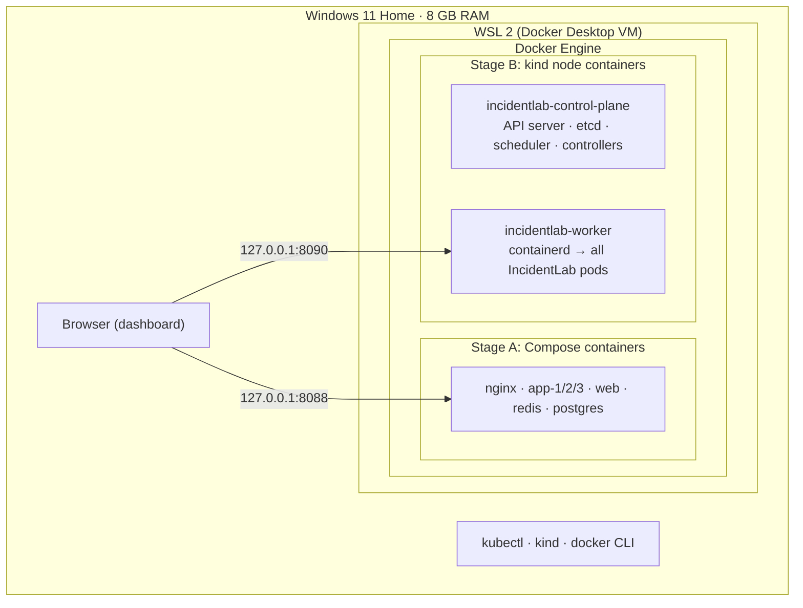
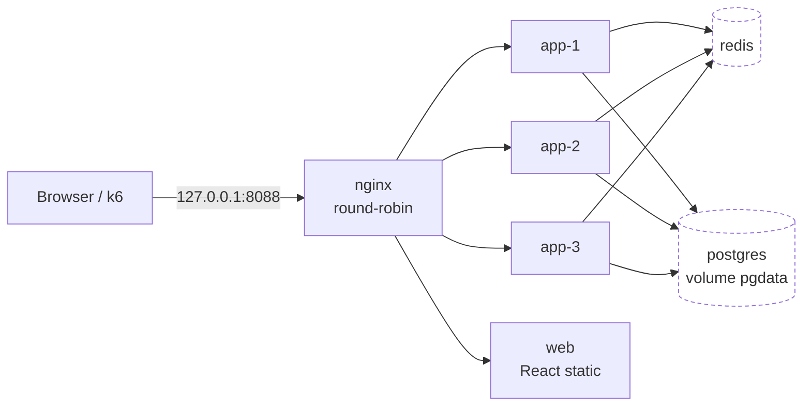
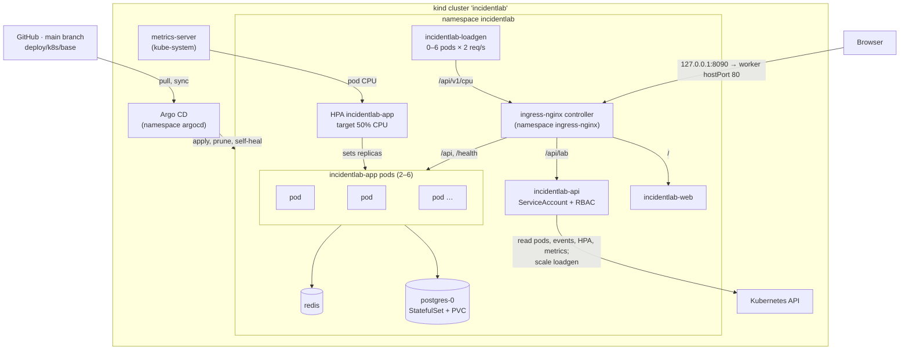
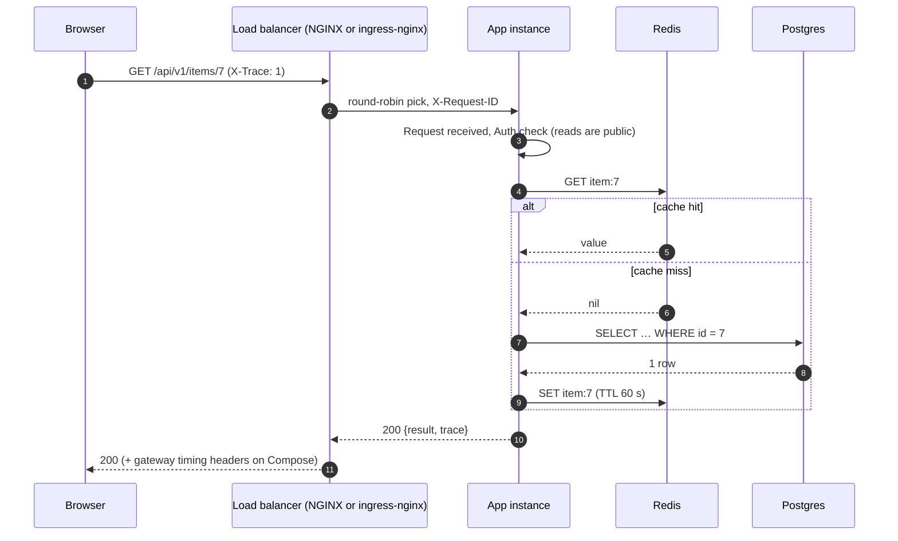
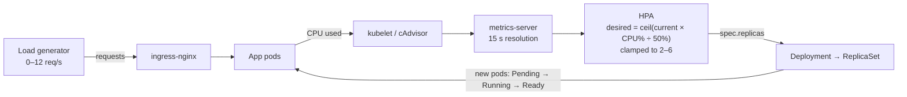
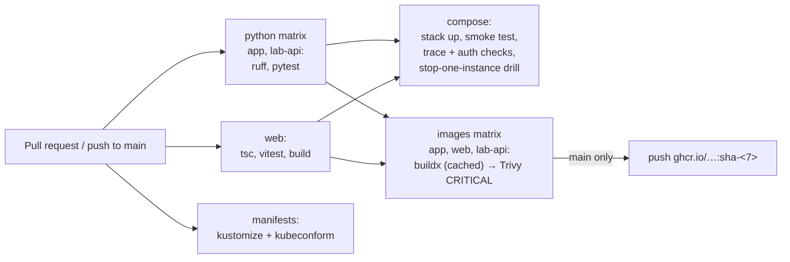

# IncidentLab architecture

IncidentLab is an incident-response training lab (formerly MiniCloud). A
*target app*, a sample web service, runs as several replicas behind a load
balancer, backed by a cache and a database. The lab breaks it on purpose and
you diagnose and fix it with real tools. A dashboard shows what happens inside:
which replica served a request, every step the request took, and how Kubernetes
adds and removes pods as load changes. Everything runs on one Windows laptop
with 8 GB of RAM; nothing uses a paid cloud service.

This document describes what is built today. The scenario engine (milestone
M1) and later milestones are in the README's roadmap and the case study.

The project runs in one of two **stages**, never both at once:

| | Stage A · Docker Compose | Stage B · Kubernetes (kind) |
| --- | --- | --- |
| Purpose | Containers, networks, volumes, load balancing | Pods, Services, Ingress, probes, autoscaling, RBAC, GitOps |
| Entry point | `http://127.0.0.1:8088` | `http://127.0.0.1:8090` |
| App replicas | 3 fixed containers (`app-1..3`) | 2–6 pods, chosen by the HPA |
| Entry point | NGINX container | ingress-nginx controller + an Ingress object |
| Deployed by | `docker compose` | Argo CD, from the `main` branch on GitHub (GitOps) |
| Autoscaling | None (Compose has no autoscaler) | HorizontalPodAutoscaler on CPU |
| Dashboard views | Request flow, Traffic split | Request flow, Autoscaling, Traffic split |
| Start | `docker compose up -d --build --wait` | `scripts\k8s-up.ps1` |
| Defined in | `deploy/compose/` | `deploy/k8s/` |

Design notes and the full roadmap: [IncidentLab case study](https://claude.ai/artifact/Xzz79Pa1g7zyx7RnqY16wS).

Updated for the IncidentLab rename on 2026-11-27 (Ingress, Argo CD, probe fixes); load levels last measured 2026-11-12: kind v0.29.0,
Kubernetes v1.33.1, metrics-server v0.7.2, Docker Engine 29.6.1.

---

## 1. Runtime layers

Both stages run inside Docker Desktop's WSL 2 virtual machine. In Stage B,
kind turns Docker containers into Kubernetes *nodes*; pods run inside those
node containers on containerd, not on the host's Docker.



Consequences that shape the design:

- Images built with `docker build` are invisible to the kind nodes until
  loaded with `kind load docker-image` (the setup script does this).
- The control-plane node is tainted `NoSchedule`, so every IncidentLab pod runs
  on the single worker. The dashboard shows this.
- Stage A and Stage B together do not fit in the ~4 GB Docker Desktop gets;
  `k8s-up.ps1` stops the Compose stack first.

---

## 2. Components

| Component | Code | Technology | Role |
| --- | --- | --- | --- |
| Target app | `app/` | Python 3.13, FastAPI, uvicorn (1 worker) | The hosted, load-balanced service. Item CRUD with cache-aside reads, CPU and latency test endpoints, health probes, Prometheus metrics, per-request step traces. |
| Load generator | `app/app/loadgen.py` | Python stdlib (same image as the app) | Sends a fixed 2 requests/s per pod to `/api/v1/cpu` through ingress-nginx (open model). Stage B only. |
| Lab API | `lab-api/` | Python 3.13, FastAPI, `kubernetes` client | The only component allowed to talk to the Kubernetes API. Returns a cluster snapshot; changes the load level. Grows into the scenario engine in M1. Stage B only. |
| Web dashboard | `web/` | React 18, TypeScript, Vite 6 (no UI or state libraries) | Request-flow visualizer, autoscaling visualizer, traffic-split view. Served as static files by unprivileged NGINX. |
| Compose gateway | `deploy/compose/nginx/` | NGINX 1.31 (unprivileged) | Stage A entry point. Routes `/api/` to app replicas (round-robin), `/` to the dashboard. |
| Ingress controller | `deploy/k8s/ingress-nginx/` (vendored), `deploy/k8s/base/ingress.yaml` | ingress-nginx | Stage B entry point. The Ingress routes `/api/lab` to the Lab API, `/api` and `/health` to the app, `/` to the dashboard. |
| Argo CD | `deploy/k8s/argocd/` (vendored install + Application) | Argo CD | Keeps the `incidentlab` namespace in sync with `deploy/k8s/base` on GitHub: automated sync, prune, self-heal, retries. Stage B only. |
| Cache | — | Redis 7.4 | Item cache, 60 s TTL, 32 MB, LRU eviction, no persistence. |
| Database | `deploy/*/postgres*` | PostgreSQL 17 | `app_db` (owned by `app_user`) holds items. `platform_db` (owned by `platform_user`) is reserved for platform metadata. |
| metrics-server | `deploy/k8s/metrics-server/` | v0.7.2, vendored | Reports pod CPU/memory to the HPA and the dashboard. Stage B only. |

---

## 3. Stage A: Docker Compose



### Networks

| Network | Members | Purpose |
| --- | --- | --- |
| `edge` | nginx, web, app-1..3 | Traffic from the gateway to the apps and dashboard |
| `internal` (`internal: true`, no outside route) | app-1..3, redis, postgres | Apps to data stores |

NGINX is not on `internal`, so it cannot reach (or even resolve) Postgres or
Redis. Only NGINX publishes a port, and only on `127.0.0.1`: Docker Desktop
would otherwise publish on every network interface.

### Gateway behaviour (`deploy/compose/nginx/nginx.conf`)

- **Upstream:** `app-1`, `app-2`, `app-3` with `resolve` and Docker's DNS
  (`127.0.0.11`, re-read every 5 s), so a recreated container with a new IP
  is found without restarting NGINX. `keepalive 16` connections.
- **Health:** passive only (open-source NGINX has no active checks):
  `max_fails=1 fail_timeout=10s`, `proxy_connect_timeout 1s`.
- **Retries:** `proxy_next_upstream error timeout http_502`, at most 2 tries.
  An app's own 503 (for example "database unavailable") is **not** retried:
  retrying it on every instance would multiply load on the failing database.
- **No backend:** a JSON `503 {"error":"no backend available","request_id":…}`.
- **Logging:** each access-log line records `upstream=` (which container
  served it), upstream status and timings.
- **Headers added for the dashboard:** `X-Upstream`, `X-Upstream-Status`,
  `X-Gateway-Connect-Time`, `X-Gateway-Header-Time`, `X-Gateway-Request-Id`.
  The client's `X-Request-ID` is passed through (or generated).

### Resource limits

| Service | CPU | Memory |
| --- | --- | --- |
| app-1..3 | 0.50 | 256 MB |
| postgres | 0.50 | 256 MB |
| web, nginx, redis | 0.25 | 64 MB |

Measured idle footprint of the whole stack: about 176 MB (before Redis was added).

---

## 4. Stage B: Kubernetes on kind



### Workloads

| Object | Kind | Replicas | Image | Notes |
| --- | --- | --- | --- | --- |
| `incidentlab-app` | Deployment | HPA: 2–6 | `incidentlab-app:dev` | No `replicas` field, so re-applying never fights the HPA |
| `incidentlab-web` | Deployment | 1 | `incidentlab-web:dev` | |
| `incidentlab-api` | Deployment | 1 | `incidentlab-api:dev` | Runs as ServiceAccount `incidentlab-api` |
| `incidentlab-loadgen` | Deployment | 0 / 2 / 3 / 6 by load level (set by the dashboard) | `incidentlab-app:dev` | `command: python -m app.loadgen`, `RATE=2` req/s per pod, stops within ~1 s on SIGTERM |
| `redis` | Deployment | 1 | `redis:7.4-alpine` | |
| `postgres` | StatefulSet | 1 | `postgres:17-alpine` | 1 Gi PVC on kind's `local-path` storage |
| `ingress-nginx-controller` | Deployment (ingress-nginx) | 1 | vendored manifest | Runs on the worker (`ingress-ready=true`), `hostPort` 80 |
| Argo CD | Deployments + StatefulSet (argocd) | 1 each | vendored manifest | Server, repo server, Redis, application controller |
| `metrics-server` | Deployment (kube-system) | 1 | `metrics-server:v0.7.2` | Patched with `--kubelet-insecure-tls` for kind |

The `incidentlab-*` images are built locally and loaded into the nodes with
`kind load docker-image`; they are never pulled from a registry.

### Services and routing

| Service | Type | Port | Used by |
| --- | --- | --- | --- |
| `incidentlab-app` | ClusterIP | 8000 | Ingress (`/api`, `/health`) |
| `incidentlab-web` | ClusterIP | 8080 | Ingress (`/`) |
| `incidentlab-api` | ClusterIP | 8000 | Ingress (`/api/lab`) |
| `redis` | ClusterIP | 6379 | App pods |
| `postgres` | Headless | 5432 | App pods (StatefulSet identity) |

The Ingress `incidentlab` (`deploy/k8s/base/ingress.yaml`) holds the routing
rules; the longest matching prefix wins, so `/api/lab` reaches the Lab API and
not the app. ingress-nginx does not send traffic through the Service's
ClusterIP: it reads the Service's **ready endpoints** and balances **per
request** across pod IPs. A pod enters the rotation only once its readiness
probe passes and leaves it when it starts terminating. kind maps
`127.0.0.1:8090` on Windows to port 80 on the worker node, where the
controller listens through `hostPort`.

### GitOps with Argo CD

The Application `incidentlab` (`deploy/k8s/argocd/incidentlab-app.yaml`)
points at `deploy/k8s/base` on the `main` branch. A merged change reaches the
cluster within about three minutes (or at once with a refresh); a local edit
does not, until it is merged.

- **prune:** an object deleted from Git is deleted from the cluster.
- **selfHeal:** a change made by hand with `kubectl` is changed back.
- **retry:** a failed sync is retried 5 times with backoff (10 s up to 3 min).
- **ignoreDifferences:** the load generator's replica count (set by the
  dashboard) and the `restartedAt` annotation (set by `k8s-up.ps1`) are
  expected runtime changes, not drift.
- The Secret `incidentlab-secrets` is not in Git: `k8s-up.ps1` creates it from
  `deploy/k8s/base/secrets.env`, and Argo CD never touches it.

kubectl is still how you look inside the cluster (`get`, `describe`, `logs`,
`events`). Changes go through Git; a hand-made change to a managed object is
reverted by self-heal.

### App pod specification

| Setting | Value | Why |
| --- | --- | --- |
| CPU request / limit | 100m / 250m | HPA percentages are relative to the request; a small request lets one pod saturate quickly |
| Memory request / limit | 96Mi / 192Mi | |
| Startup probe | `GET /health/live`, delay 2 s, every 2 s, timeout 1 s, up to 30 failures (~60 s) | Liveness doesn't kill a slow-starting pod |
| Readiness probe | `GET /health/ready` every 3 s, timeout 2 s, 3 failures | Controls membership in the Service's ready endpoints |
| Liveness probe | `GET /health/live` every 10 s, timeout 5 s, 6 failures | Never checks dependencies; tolerant enough that a pod busy under load isn't restarted |
| `preStop` | `sleep 5` | ingress-nginx stops routing to the pod before shutdown begins |
| `terminationGracePeriodSeconds` | 20 | |
| Rolling update | `maxSurge: 1`, `maxUnavailable: 0` | Capacity never drops during a rollout |
| PodDisruptionBudget | `minAvailable: 1` | A node drain can't remove every pod |
| `INSTANCE_ID` | Pod name via the downward API | Shows up in `X-Pod-Name` |
| Security | Non-root, `RuntimeDefault` seccomp, no privilege escalation, all capabilities dropped | |

### Namespace security

`incidentlab` enforces Pod Security **baseline** and warns on **restricted**.
App, web, Lab API and load generator meet restricted.
Postgres and Redis use their official images, which start as root, so they
produce warnings (allowed at baseline).

---

## 5. Request flow and tracing

### Path of one request



### Item endpoints (`app/app/items.py`)

| Method | Path | Auth | Steps in order |
| --- | --- | --- | --- |
| GET | `/api/v1/items` | public | DB `SELECT recent items` |
| POST | `/api/v1/items` | Bearer token | auth → validate → DB `INSERT` → cache write-through |
| GET | `/api/v1/items/{id}` | public | cache lookup → on miss DB `SELECT` → cache fill |
| PUT | `/api/v1/items/{id}` | Bearer token | auth → validate → DB `UPDATE` → cache invalidate |
| DELETE | `/api/v1/items/{id}` | Bearer token | auth → DB `DELETE` → cache invalidate |

Other app endpoints: `/health/live`, `/health/ready`, `/api/v1/info`,
`/api/v1/cpu?ms=N` (busy loop, max 2000), `/api/v1/slow?ms=N` (sleep, max
10000), `/metrics`.

Every response carries `X-Request-ID`, `X-Pod-Name`, `X-App-Version` and
`Server-Timing` (`app;dur=…, db;dur=…`).

### The trace

`app/app/trace.py` records each step with real timings. A client that sends
`X-Trace: 1` gets the response wrapped as `{"result": …, "trace": …}`; other
clients get the plain result.

```json
{
  "instance": "incidentlab-app-66465d759c-dmjlj",
  "version": "dev",
  "method": "GET",
  "path": "/api/v1/items/2",
  "status_code": 200,
  "total_ms": 18.08,
  "scenario": { "cache": "force-miss", "db_error": false, "network_ms": 0, "enabled": true },
  "steps": [
    { "node": "app",   "name": "Request received", "status": "ok",   "started_ms": 0.0,  "duration_ms": 0.02, "detail": {} },
    { "node": "app",   "name": "Auth check",       "status": "skipped", "…": "…" },
    { "node": "cache", "name": "Cache lookup",     "status": "miss", "detail": { "key": "item:2" } },
    { "node": "db",    "name": "SELECT item by id", "status": "ok",  "detail": { "sql": "SELECT …", "params": [2], "rows": 1 } },
    { "node": "cache", "name": "Cache fill (after miss)", "status": "ok", "detail": { "key": "item:2", "ttl_s": 60 } }
  ]
}
```

Step `node` is one of `app`, `cache`, `db`, `network`; `status` is one of `ok`,
`hit`, `miss`, `error`, `skipped`, `simulated`. The bearer token is never
echoed: the auth step records only whether one was sent and whether it matched.

### Scenarios

Sent as request headers and honoured only when the app runs with
`SIMULATION_ENABLED=true` (on in both lab stages; a lab-only switch).

| Header | Effect |
| --- | --- |
| `X-Sim-Cache: force-miss` | Deletes the key before the lookup |
| `X-Sim-Cache: force-hit` | Warms the key first (recorded as a setup step) |
| `X-Sim-DB-Error: 1` | The database step fails as "connection refused (simulated)" → 503 |
| `X-Sim-Network-Ms: N` | Adds N ms (max 5000), half before and half after the work |

Auth scenarios (valid, wrong or no token) need no special header: the
dashboard sends the right, a wrong or no `Authorization` header.

### Failure behaviour

| Failure | Behaviour |
| --- | --- |
| Redis down | Lookup and fill fail fast (0.5 s timeouts each); the request is served from Postgres. About 1 s slower; still 200. |
| Postgres down | DB step error → 503 `{"error":"database unavailable"}`. The load balancer does not retry it. Readiness is unaffected (see below). |
| One app instance down (Compose) | The first request to it waits the 1 s connect timeout, then is retried on another instance; later requests skip it for 10 s. |
| One app pod not ready (Kubernetes) | It is not in the Service's ready endpoints, so ingress-nginx never sends it traffic. |
| All app instances down | The load balancer answers 503 itself (Compose: JSON `no backend available`; ingress-nginx: its own 503 page). |

**Readiness does not check the database.** If it did, a database blip would
mark every replica unready at once and take the whole service down.
`READINESS_CHECKS_DB=true` turns the check on for that drill.

---

## 6. Autoscaling

### The control loop



| HPA setting | Value |
| --- | --- |
| Target | 50% average CPU utilisation (50m per pod) |
| Replicas | min 2, max 6 |
| Tolerance | ±10% (Kubernetes default): no change inside it |
| Scale-down stabilisation | 60 s (demo setting; Kubernetes default is 300 s) |
| Scale-up | Kubernetes defaults (immediate) |

Only **pods** scale. kind's nodes are fixed containers, so there is no node
autoscaler: a pod that doesn't fit stays `Pending`.

### Probe events during a scale-up

The event stream shows probe warnings during every scale-up. Most are expected;
one kind is a real risk.

| Event | Cause | Effect |
| --- | --- | --- |
| `Startup probe failed … connection refused`, 2–3 per new pod | The probe runs before uvicorn listens; Python startup is slower while the node's CPU is saturated | None. 2–3 of the 30 allowed failures; the pod becomes Ready a few seconds later with 0 restarts |
| `Readiness probe failed … context deadline exceeded` on a busy pod | A pod saturated by `/api/v1/cpu` work answers `/health/ready` slower than the 1 s timeout | Intended: the pod leaves the rotation until it can answer again |
| `Liveness probe failed … context deadline exceeded` on a busy pod | Same slowness, but liveness shares the 1 s timeout | **Risk:** 3 in a row restart a healthy but busy pod, removing capacity at peak load. Observed 3 such failures on one pod under heavy load. See limitations. |
| `Readiness probe failed … connection refused` on a terminating pod | The pod is shutting down after its `preStop` pause | None: it has already left the endpoints |

### Load levels

The load generator uses an **open model**: each pod starts `RATE` requests per
second (2) on a fixed schedule, whether or not earlier requests have finished,
like real users. The dashboard picks a level and the Lab API sets the
number of load-generator pods.

| Level | Load pods | Requests/s | App pods reached (measured 2026-11-12) |
| --- | --- | --- | --- |
| Off | 0 | 0 | 2 (minimum) |
| Light | 2 | 4 | 3, steady at ~45% CPU |
| Medium | 3 | 6 | 4, steady at ~49% CPU |
| Heavy | 6 | 12 | 6 (max), ~72–82% CPU |

Each request/s costs about 32m of CPU, and the HPA aims for 50m per pod, so
pods ≈ ceil(req/s × 32 ÷ 50).

The first version kept 3 requests **in flight** per load pod (a closed model).
That is about one core of constant demand per pod, so even "Light" held every
replica above target, and the HPA never scaled down between levels. The
open-model generator fixed that.

### Measured behaviour (2026-11-12)

| Time | Event |
| --- | --- |
| 0 s | Heavy on (12 req/s) |
| ~30 s | CPU first visible (metrics-server reports about every 15 s); HPA 2 → 4 |
| ~75–90 s | 4 → 5 → 6 as CPU stays above target |
| 120 s | Switch to Light (4 req/s) |
| ~180 s | CPU below target (metrics lag) |
| ~225 s | Stabilisation window ends: 6 → 3, three pods terminate |
| 330 s | Switch to Medium (6 req/s): 3 → 4 about 30 s later |
| Load off | After the 60 s window, back to 2 |

### Lab API (`lab-api/`)

| Endpoint | Auth | Returns / does |
| --- | --- | --- |
| `GET /api/lab/health` | none | `{"status":"ok"}` (readiness probe) |
| `GET /api/lab/cluster` | none (localhost lab) | Snapshot: nodes, app pods (stage, node, CPU vs request, memory, restarts), HPA status, load level, load pods and req/s, last 30 events |
| `POST /api/lab/load` `{"level":0-3}` | Bearer token | Sets `incidentlab-loadgen` to 0 / 2 / 3 / 6 pods; writes an audit log line |

Fetching (Kubernetes calls) and shaping (plain dict → dict) are separate, so
the shaping is unit-tested without a cluster. Missing metrics come back as
`null` and the dashboard shows "—", never 0.

### RBAC: everything the Lab API may do

| Scope | API group | Resources | Verbs |
| --- | --- | --- | --- |
| Role (namespace `incidentlab`) | core | pods, events | get, list, watch |
| | autoscaling | horizontalpodautoscalers | get, list, watch |
| | metrics.k8s.io | pods | get, list |
| | apps | deployments/scale, **only** `incidentlab-loadgen` | get, patch |
| ClusterRole | core | nodes | get, list |

It cannot delete pods, change the app Deployment, read Secrets, or touch any
other namespace. The browser never talks to Kubernetes directly.

---

## 7. Dashboard (`web/`)

React + TypeScript, built by Vite, served by NGINX. Same origin as the APIs,
so no CORS. No component or state libraries; diagrams and charts are plain SVG.

| View | Source | Updates | What it shows |
| --- | --- | --- | --- |
| **Request flow** (`src/flow/`) | One real request with `X-Trace: 1` | On send | Animated packet through Browser → load balancer → instance → Cache / DB → back. Play / pause / step / restart, speed 0.25×–4×. Inspector (step details, request, response), processing log, history of 12 runs. On Kubernetes, the instance column is the live pod list (every 5 s). |
| **Autoscaling** (`src/scale/`) | `GET /api/lab/cluster` | Every 2 s | Load buttons; pods inside node boxes, coloured by stage, removed pods fading out; HPA phase in words, formula with live numbers, highlighted loop step, scale-down countdown; 5-minute CPU and pod-count chart; event stream |
| **Traffic split** (`src/TrafficView.tsx`) | Many `GET /api/v1/info` | On send | Requests per instance, failures, last 15 requests |

Key modules:

- `flow/buildSteps.ts`: turns a run (request, response headers, trace) into
  animation frames. Pure function, unit-tested.
- `flow/usePlayback.ts`: frame index and progress driven by `requestAnimationFrame`.
- `scale/derive.ts`: the HPA formula (with tolerance and min/max) and the
  current phase (starting, warming, scaling up, at max, cooling, scaling down,
  stable). Pure, unit-tested.

Animation speed is a display choice. Every duration shown in the inspector is
measured. The API token is kept in `localStorage` (`incidentlab.apiToken`) and
masked in the request inspector.

---

## 8. Data

| Database | Owner role | Contents |
| --- | --- | --- |
| `app_db` | `app_user` | `items(id BIGSERIAL, name TEXT, created_by TEXT, created_at TIMESTAMPTZ)`. `created_by` is the instance that wrote it. |
| `platform_db` | `platform_user` | Empty: reserved for deployment, test-run and event history |

- Both databases and roles are created on first start by
  `01-databases.sh` (Compose) / `postgres-init.sh` (Kubernetes ConfigMap).
  `PUBLIC` access is revoked; the app role cannot open `platform_db`.
- The `items` table is created by the app on first use
  (`CREATE TABLE IF NOT EXISTS`). Proper migrations come later.
- Connection pools are small (Compose 4, Kubernetes 2 per pod) so that
  replicas × pool stays under Postgres' default 100 connections at 6 pods.
- **Persistence.** Compose: named volume `pgdata` survives `down`, removed by
  `down -v`. Kubernetes: a PVC on kind's `local-path` storage inside the node
  container, so `kind delete cluster` deletes it. Backups are not yet automated.
- Redis holds only cache entries (`item:{id}`, 60 s TTL) and is safe to lose.

---

## 9. Configuration and secrets

| Setting | Compose (`deploy/compose/.env`) | Kubernetes |
| --- | --- | --- |
| `POSTGRES_PASSWORD`, `APP_DB_PASSWORD`, `PLATFORM_DB_PASSWORD` | `.env` | Secret `incidentlab-secrets`, created by `k8s-up.ps1` from `deploy/k8s/base/secrets.env` (not in Git, so not managed by Argo CD) |
| `API_TOKEN` (writes, load control) | `.env` | same Secret |
| `SIMULATION_ENABLED` | `.env`, default `true` | `true` in `app.yaml` |
| `READINESS_CHECKS_DB` | `.env`, default `false` | not set (false) |
| `INCIDENTLAB_PORT` | `.env`, default `8088` (8080 is taken on this PC) | fixed: `127.0.0.1:8090` |
| `DATABASE_URL`, `REDIS_URL`, `DB_POOL_MAX` | `compose.yaml` | `app.yaml` |

- `.env` and `secrets.env` are git-ignored; `*.example` files are committed.
- Kubernetes Secrets are base64, not encrypted: fine for a local lab only.
- Changing a value in `secrets.env` needs `k8s-up.ps1` (updates the Secret)
  and a restart of the pods that read it; Secrets read as environment
  variables are not reloaded.

---

## 10. Build and delivery

### Images

| Image | Dockerfile | Base | Notes |
| --- | --- | --- | --- |
| `incidentlab-app` | `app/Dockerfile` | `python:3.13-slim` | Two stages (build venv → runtime), uid 10001, exec-form `CMD`, `HEALTHCHECK`, `APP_VERSION` and `GIT_SHA` build args |
| `incidentlab-api` | `lab-api/Dockerfile` | `python:3.13-slim` | Same pattern, uid 10001 |
| `incidentlab-web` | `web/Dockerfile` | `node:22-alpine` → `nginxinc/nginx-unprivileged:1.31-alpine` | Static build served on 8080 |

Dependencies are copied before source code, so code-only changes reuse the
cached dependency layer.

### Local setup (`scripts/k8s-up.ps1`)

1. Start Docker Desktop if it isn't running, and wait up to 3 minutes.
2. Stop the Compose stack.
3. Create the kind cluster from `deploy/k8s/kind-config.yaml` if missing;
   otherwise start stopped node containers.
4. Wait for the API server. After a Docker restart the node containers can get
   new (even swapped) IPs; if the control-plane kubelet still points at an old
   IP, repoint it to the node's hostname. Wait for every node to be Ready.
5. Build the three images and `kind load` them into the nodes (skip with
   `-SkipBuild`).
6. Check the cluster network: each node has a route to the other node's pod
   range, and a pod can resolve cluster DNS. If not, restart kindnet,
   kube-proxy and CoreDNS and check again; stop with a clear message if that
   doesn't help.
7. Install metrics-server, ingress-nginx (and wait for its admission webhook)
   and Argo CD.
8. Create the namespace (if missing) and the Secret, then apply the Argo CD
   Application and wait until it is Synced and Healthy.
9. Restart the Deployments (same `:dev` tag, new image), wait for each rollout.

`scripts/k8s-down.ps1` deletes the cluster after a typed confirmation.
kind v0.29.0 lives in `.tools/kind.exe` (checksum-verified, git-ignored).

### CI (`.github/workflows/ci.yml`)



- The token has `contents: read` by default; only the image job gets `packages: write`.
- Dependabot keeps actions, pip, npm and Docker base images current.
- CI cannot reach the laptop's cluster, and nothing exposes it. Deploying to
  kind is done locally by `k8s-up.ps1`.

---

## 11. Ports

| Address | What |
| --- | --- |
| `127.0.0.1:8088` | Stage A entry (Compose NGINX), configurable via `INCIDENTLAB_PORT` |
| `127.0.0.1:8090` | Stage B entry (kind `extraPortMappings` → worker port 80 → ingress-nginx); Argo CD at `argocd.localhost:8090` |
| `:8000` (internal) | App, Lab API |
| `:8080` (internal) | Web, Compose NGINX |
| `:6379` / `:5432` (internal) | Redis / Postgres, never published |

---

## 12. Testing

| Suite | Location | Count | Covers |
| --- | --- | --- | --- |
| App | `app/tests/` | 38 | Health, identity headers, metrics, bounds; load generator (in-flight slot released on every error, RATE validation); item flows against in-memory fakes of Redis and Postgres: hit/miss, forced scenarios, auth, validation, cache-down fallback, scenarios disabled |
| Lab API | `lab-api/tests/` | 12 | Quantity parsing, pod stages, HPA/node/event shaping, load endpoint auth, 503 when the cluster is unreachable |
| Web | `web/src/**/*.test.ts` | 27 | Traffic tally, request-flow frame building (hit, miss, DB error, retry, no backend, network error, ingress-nginx without gateway headers), HPA formula and phases |
| Manifests | CI | 34 resources | Schema validation for Kubernetes 1.33 |
| End to end | CI `compose` job, plus manual runs | — | Load distribution, cache hit after write, 401 without token, zero failures with one instance stopped |

Drill records live in `docs/drills/`.

---

## 13. Repository map

```
app/                     target app (+ load generator)
  app/main.py            FastAPI app, middleware (headers, metrics), health, cpu/slow
  app/items.py           traced item endpoints and scenarios
  app/trace.py           step recorder
  app/cache.py           Redis client (0.5 s timeouts)
  app/db.py              Postgres pool and SQL
  app/loadgen.py         load generator
lab-api/                 Lab API
  app/main.py            endpoints, token check, audit log
  app/cluster.py         Kubernetes reads and shaping
web/                     dashboard
  src/flow/              request-flow visualizer
  src/scale/             autoscaling visualizer
  src/TrafficView.tsx    traffic split
deploy/compose/          Stage A: compose.yaml, nginx.conf, Postgres init, .env.example
deploy/k8s/              Stage B
  kind-config.yaml       1 control-plane + 1 worker, port mapping
  base/                  Kustomize: namespace, workloads, Services, Ingress, HPA, PDB, RBAC
  metrics-server/        vendored v0.7.2 + kind patch
  ingress-nginx/         vendored controller manifest (kind flavour)
  argocd/                vendored Argo CD install + the incidentlab Application
scripts/                 k8s-up / k8s-down, traffic and drill helpers (PowerShell)
docs/                    this file, drill records, Docker exercise log
.github/                 CI workflow, Dependabot
```

---

## 14. Known limitations

- **One machine.** Several replicas or two nodes are not separate servers; a
  laptop failure takes everything down. kind nodes share the same CPU.
- **Local performance only.** Load tests measure this laptop; the load
  generator competes with the app for CPU.
- **Single Postgres, no backups yet.** Kubernetes data is lost with the cluster.
- **No Prometheus yet.** Pod CPU comes from metrics-server; per-pod request
  rates and latency percentiles are not shown on the Autoscaling view.
- **Ingress, not Gateway API.** Gateway API is a possible later lab.
- **No schema migrations.** The table is created on first use.
- **Lab-grade secrets.** Example passwords and `demo-token` must be changed;
  Kubernetes Secrets are not encrypted at rest.
- **`/api/lab/cluster` has no authentication.** Acceptable only because the
  entry point is bound to `127.0.0.1`.
- **Multi-node kind and Docker restarts.** kind doesn't officially support
  restarting multi-node clusters; `k8s-up.ps1` repairs the known failure
  (node IPs changed, control-plane kubelet pointing at the old IP, missing pod
  routes). If the repair fails, recreate the cluster.
- **Pods often start between refreshes.** Images are already on the node, so
  the Pending and ContainerCreating stages often pass between 2 s polls.
